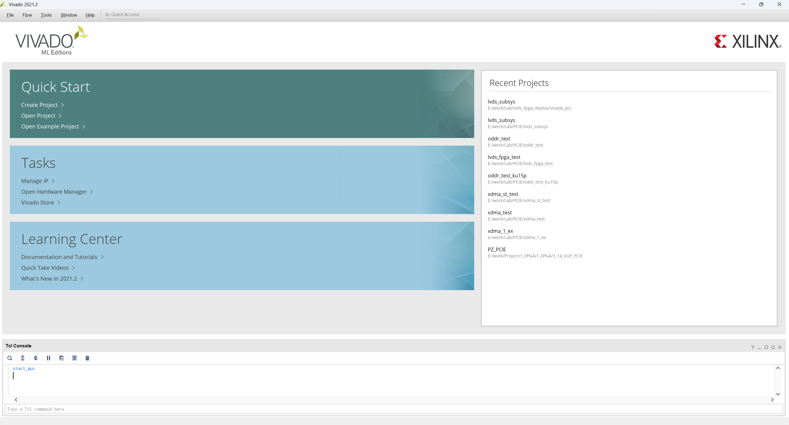

# Introduction
This is a project on LVDS communication using a Xilinx FPGA.

## device part
xcvu13p-fhgb-2-i

## vivado version
Vivado 2021.2
(Note: This guide is based on Vivado 2021.2. For later versions, the procedure is the same, except that all IPs must be regenerated.)

# First-Time Project Creation

## open vivado
Run the command in the current directory.
```bash
vivado -mode gui
```

## create project and load design
Run the command in Vivado's tcl console.
```bash
source main.tcl
```


## Simulation, Synthsis or Implementation
Use the GUI

# Opening an Existing Project
To open an existing project, click the .xpr file in the vivado_prj folder.